# SkySheep

<div align="center">

[](https://sheepsky.com/)

**A local AI workbench for multi-model collaboration — turn one model's work into a coordinated, controllable team.**

[](https://github.com/Sky-scrape/SkySheep/actions/workflows/ci.yml)


[](README.md)
[](https://m8ven.ai/mcp/sky-scrape/skysheep)

[🌐 Website](https://sheepsky.com/) · [⬇️ Download](https://github.com/Sky-scrape/SkySheep/releases/latest) · [📖 中文文档](README.md)

</div>

SkySheep is an open-source AI Agent workbench that runs on your own computer: a Python asyncio engine, a pywebview desktop shell, and a zero-build frontend, MIT-licensed. It reads and writes files, edits code, runs commands, searches the web, handles documents, operates your computer, and keeps multi-step work moving through sub-agents, scheduled tasks, and pipelines.

Its defining idea is not "another chat window". It makes **multi-model collaboration** a native workflow inside one task:

- **Roundtable**: several models answer in parallel, then a chairman model fuses the drafts into one response;
- **Team**: split work by role and use a channel plus task board to dispatch, report, accept, and deliver;
- **Adversarial**: assign discovery, investigation, recommendation, and judgment to roles built to find blind spots;
- **Relay**: alternate turns between a main and peer session to connect proposal, execution, feedback, and revision.

You still stay in charge of sensitive actions: file writes and command execution ask for confirmation by default, writes include a diff preview, and file changes are snapshotted per round for rollback. SkySheep has no cloud service of its own; sessions, configuration, and keys stay on your machine. When you enable a hosted model, conversation content is sent to the provider you selected, according to your configuration.

<div align="center">

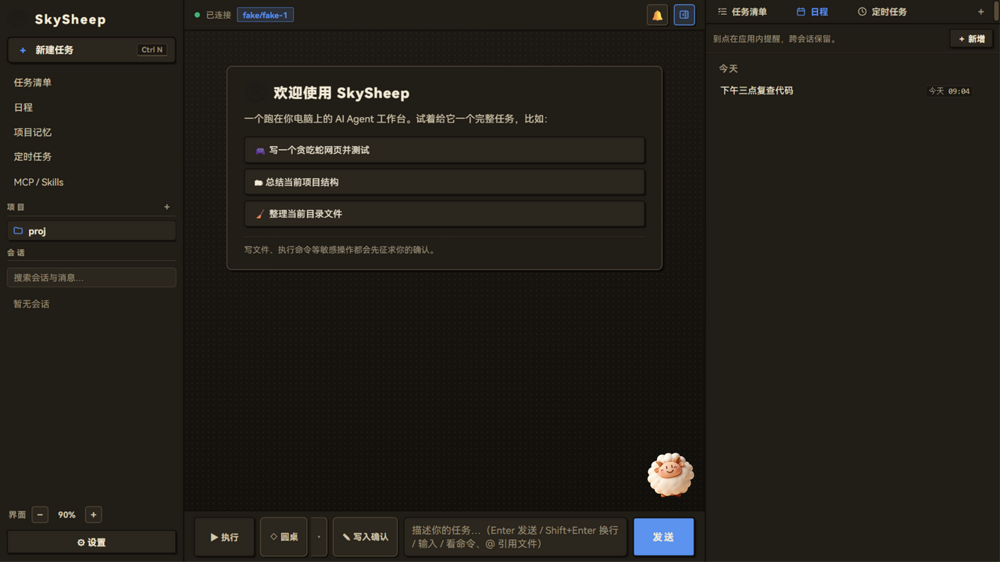

*The full "Night-ink" dark theme: sessions on the left, conversation in the middle, the workbench panel and desktop pet on the right*

</div>

## 🎯 What it is good for

SkySheep is built for work that needs an agent to actually touch things while keeping the process visible and controllable:

**Tame files and documents** — "Sort half a year of downloads into folders by type", "pull key figures from dozens of PDFs into one Excel sheet". File read/write with precise editing and PDF / Word / Excel / PPT / CSV parsing are built-in tools — describe the job instead of writing a script first; moves and deletes go through reversible dedicated operations, so a mistake can be undone.

**Work inside an existing project** — read the code, locate the bug, edit files, run the tests; undo the whole round with one click if the result isn't right. Fits config changes, batch refactors, and small tools with clear acceptance criteria.

**Turn repetitive chores into scheduled automation** — "Every morning at 8, fetch new content from these sites, summarize it, and push it to our Feishu group", "compile the weekly report every Friday afternoon". Scheduled tasks handle the firing and pipelines handle the multi-step dependencies and output passing; export a task to the Windows Task Scheduler and it fires even when the app is closed.

**Operate the computer for you** — screenshot, mouse, keyboard, windows, clipboard (off by default; enable in settings). Built for repetitive UI chores like clicking "export" across a row of apps.

**Stay in control while away from the desk** — open the full UI from your phone's browser with confirmation cards intact; dispatch work and receive daily digests and completion notices over Feishu / WeChat.

## 📦 Capability overview

- **Multi-model collaboration**: roundtable (parallel answers + chairman fusion) · team (roles + task board + AI director) · adversarial (four-role fault-finding pipeline) · relay (main and peer screens alternating)
- **Execution**: file read/write and precise editing · command execution (with background processes) · regex and glob search · web fetch and search · PDF / Word / Excel / PPT / CSV I/O · image understanding and AI image generation · sub-agents (optionally in an isolated worktree)
- **Automation**: scheduled tasks · dependency pipelines (DAG) · factory board (cross-project observability / dispatch · day-night and real weather) · agenda reminders · export to the Windows Task Scheduler · Feishu / WeChat / Webhook pushes · daily run digests
- **Extensions**: MCP (two transports, seven presets) · Skills (twenty official templates) · Mods (experimental) · global egress (proxy / bypass list / self-signed CA)
- **Desktop**: six themes · phone remote access and Tailscale · multi-tab terminal · desktop pet · Chinese-aware full-text search · per-round checkpoint rollback

## 🧠 Design principles

### The three columns are not decoration

Sessions and entry points on the left, conversation in the middle, everything auxiliary on the right: files, browser, review, tasks, agenda, automation, project memory, memory map, relay, MCP and skills. The auxiliary area is one tabbed panel rather than floating windows scattered over the conversation, because what an agent run lacks is not more prompts but seeing what it is touching and how far it has got, all on one screen. A multi-tab terminal sits at the bottom (Ctrl+\`) so running a command never means switching windows.

### A smarter agent needs better context

Once context gets muddled, even a strong model is only guessing. So project, session, memory, and skills are kept apart and injected on demand: a project binds the working directory, and sub-agents, pipelines, skills and MCP follow that project; a session handles one specific piece of work; memory is split between project memory and global memory, with the oversized part injected by per-turn relevance; a skill hands its body to the model only when it is actually needed (20,000 characters max). Keep the partitions clean and the model sees exactly the slice it should.

### Every step is visible, controllable, and reversible

Letting an agent touch your files and commands only works if you can survive the mistake. So confirmation prompts, diff previews, the command whitelist, and change snapshots are defaults rather than options: read-only actions run through, writes and commands confirm every time, each round of changes is snapshotted for one-click undo, and two parallel tasks writing the same file must claim a write lease first.

### A judgement worth making is worth more than one model

A single model's answer reads fluently and is still one viewpoint. The roundtable has several models answer and a chairman fuse; the team puts roles in front of each other for acceptance; adversarial review assigns a stage to nothing but fault-finding. The extra time and tokens stay controllable — pick per-member models (cheap models as members, a strong one as chairman), and lean on the budget guardrail, round caps, and draft dedupe.

## 👥 Multi-model collaboration: models take different parts of one turn

Multi-model here doesn't mean opening three windows and asking the same question. It means models take different parts of one task. Roundtable, team, and adversarial modes are selected in the composer, with only one active per turn.

| | Roundtable | Team | Adversarial |
|---|---|---|---|
| Who speaks | Members answer independently in parallel; the chairman fuses them | A director dispatches tickets; members report by role in the channel | Discover → investigate → recommend → judge, four roles in sequence |
| Fits | Wanting one answer with fewer blind spots | A big task that needs splitting and tracking | Reviews that must find fault: plans, code, contracts |
| How it converges | Every draft fused into one final answer | Tickets accepted one by one, or sent back | The judge rules; upheld findings become tickets to verify |
| Cost control | Seven mechanisms (dedupe, light context, fusion budget, …) | Global round cap + forced delivery on budget overrun | Four serial stages: time bought for thoroughness |
| Permissions | Its own permission gate | Its own permission gate | Pure text reasoning, no permission gate |

**Roundtable — one question, several models answering.** Members answer independently in parallel; the chairman (your main conversation model) fuses every draft into a single final answer, so sharp criticism and safe conclusions both survive. Members can wear identity presets (critic, fact-checker, minimalist, pragmatist, and more), an optional debate round lets them read each other's drafts and revise once, and A/B mode keeps each member's original answer. Every draft is stored with the session for later review, citation, and follow-up.

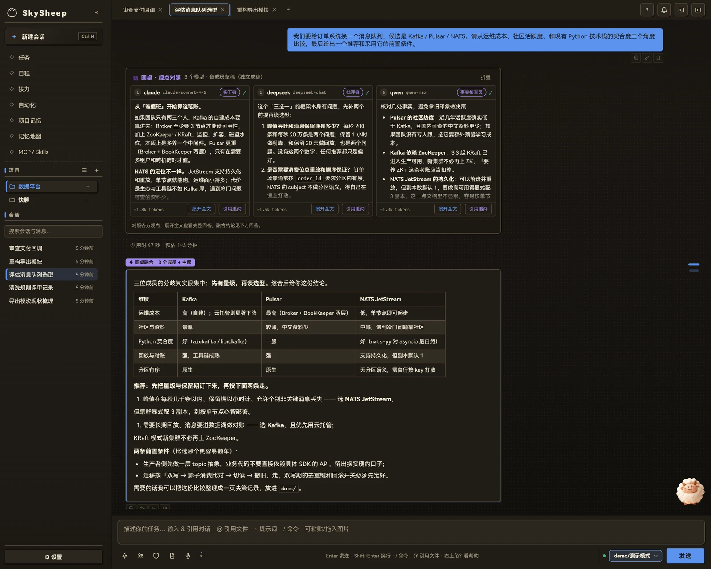

**Team — work split by role, tracked on a task board.** One big task becomes a set of tickets; each teammate has its own role, model, and tool scope, reports in the team channel, and gets accepted or sent back for rework. There are two kinds of director: you (every message you send is an instruction) or an AI director (pick a model as director and it drives decompose → dispatch → collect → accept → deliver on its own, while you keep the right to interrupt, take over, and call it off). When a few members need to hash something out, a "small meeting" runs a roundtable inside the channel without derailing the main line. Runaway guards include a global round cap, forced adjudication when rework loops exceed the limit, hand-off to the director when a member stalls, and forced delivery when the token budget is crossed.

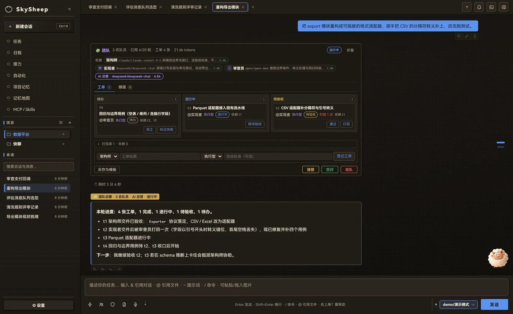

**Adversarial — a review pipeline built to find fault.** It doesn't aim for a pretty answer; it aims to dig problems out. Each of the four roles sees only its own slice. Finding a problem pays better than nodding along (asymmetric incentives), stage contexts are isolated from each other, and if one stage fails the pipeline degrades to a usable conclusion instead of collapsing. A finding the pipeline upholds can be ticked and registered as a consulting ticket for a team member to verify.

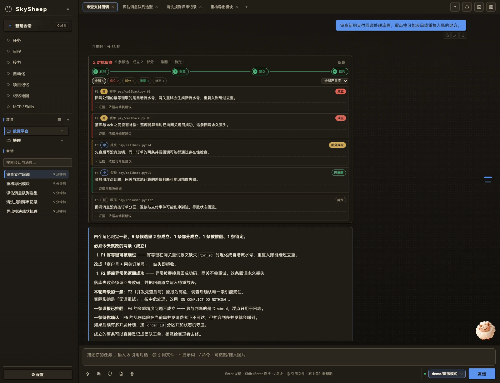

One thing that's easy to misread: relay is not a fourth member of that trio. It is a standalone workbench for work that hands off back and forth ("propose → execute → feedback → revise"). Open "Relay" from the sidebar, fill in the overall task and each side's per-turn task on the right-side board, then hit Run to let the side whose turn it is execute a full, normal Agent turn (agent loop, tools, permission gate, and checkpoints all apply). The baton passes automatically and the next turn carries the other side's previous output; "Continuous alternation" runs the turns back to back. Both sides' transcripts stay in their own sessions. Design notes: [docs/接力模式设计.md](docs/接力模式设计.md).

## 🔍 Feature walkthrough

### A full file write in one message

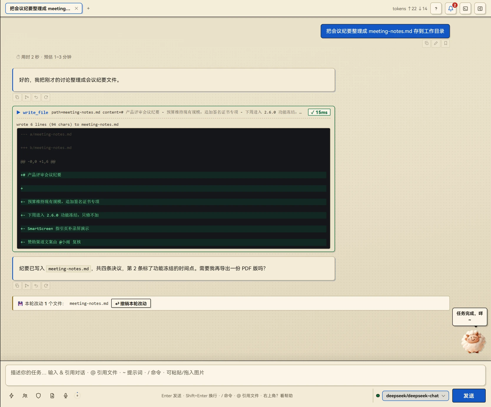

You say "put the meeting notes into meeting-notes.md in the working directory" — and a whole sequence happens: the model decides to call `write_file` → the permission gate judges it against your current tier → the confirmation card shows a diff preview → the file lands → the conversation footer summarizes "1 file changed this round" with "Undo this round" right beside it. Tool timings, diffs, and the change list never require digging through logs. To cut the interruptions, switch the tier to "Auto-edit" and writes inside the working directory stop asking one by one, while anything outside it is still blocked and confirmed.

### Models, usage, and cost

| Paste a key into a built-in preset | Usage and cost, per session |
|:---:|:---:|
| 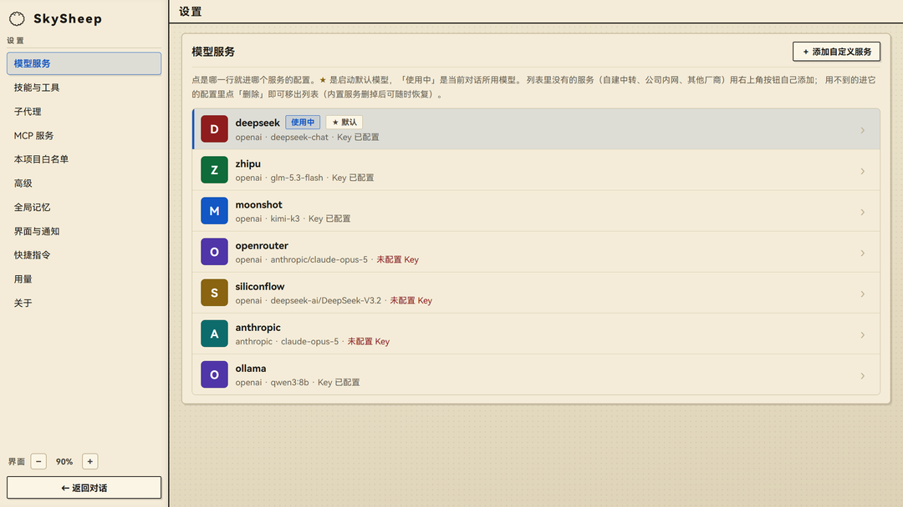 | 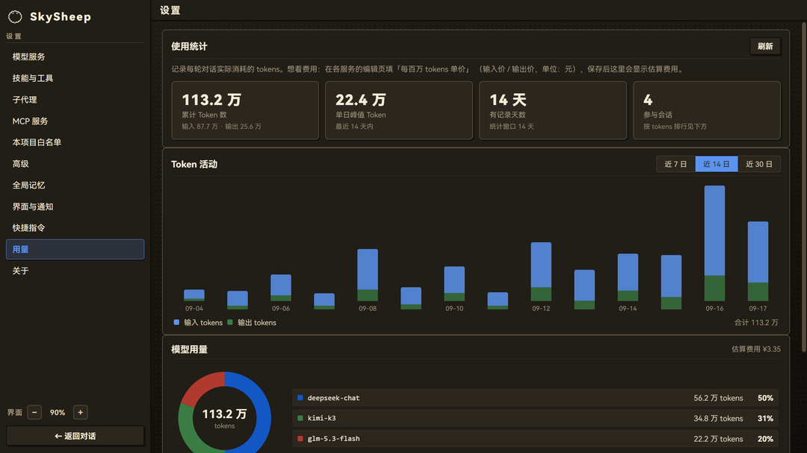 |

Ten built-in cloud presets (Anthropic / OpenAI / Gemini / xAI / MiniMax / DeepSeek / Zhipu / Kimi / Qwen / Xiaomi MiMo), plus custom relay endpoints and local inference services (LM Studio, Ollama). One click detects the model list, context windows, and capabilities (streaming / tools / vision / reasoning), with a masked diagnostic report. Usage is tallied by session / provider / model with cost estimates, and a daily budget guardrail pushes a channel alert at the 80% and 100% tiers. Reasoning effort is auto-tuned per task; when you want to know why a turn was slow, the review page's turn diagnostics break out tool counts and the slowest tool, permission waits, and tokens.

### Scheduled tasks and agenda

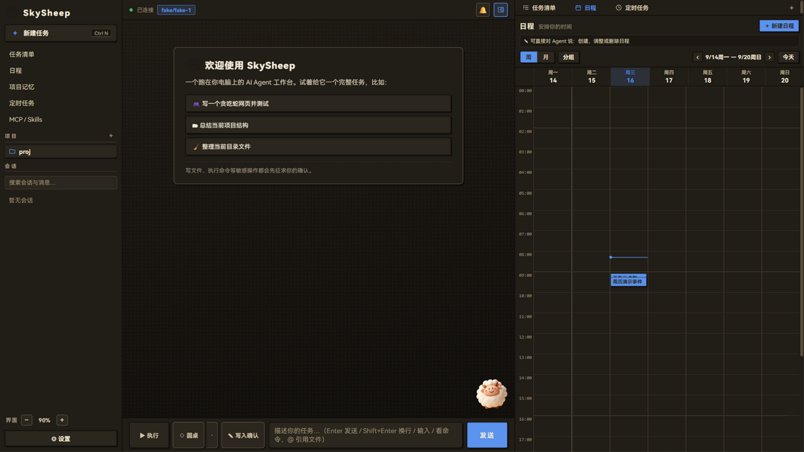

Scheduled tasks cover one-shot, interval, and complex schedules ("every 20 minutes between 10:00 and 12:00 on weekdays") and can pre-authorize tools so unattended runs don't stall on prompts; agenda reminders come with weekly / monthly views and advance reminders. Final states and a daily digest can be pushed to Feishu / WeChat / a Webhook. One caveat worth stating plainly: in-app schedules only fire while SkySheep is running — choose "Minimize to system tray" when closing to keep it going in the background, and tasks that come due while fully exited are caught up at the next launch. To fire with the app fully closed, export the task to the Windows Task Scheduler from its card ("⊞").

The **factory board** lays every project's scheduled tasks and pipelines onto one isometric site: each line is a machine, each real run is a parcel moving along a conveyor. Click a factory header to zoom in and see machine names, the tool currently running, and elapsed time; dispatch, pause, or stop runs across projects. "Needs attention" lists failures, empty output, and runs that finished with blocked tools; "Made today" counts `outcome = ok`, so runs blocked by the gate are never reported as successes. The scene switches between day and night by local time; fill in a city under factory settings and enable "real weather" to render rain, snow, fog, and lightning from the local sunrise/sunset and weather code. The city name is only used to look up coordinates — no IP geolocation, and no network request at all while weather is off. All factory methods are local-only; remote connections are rejected.

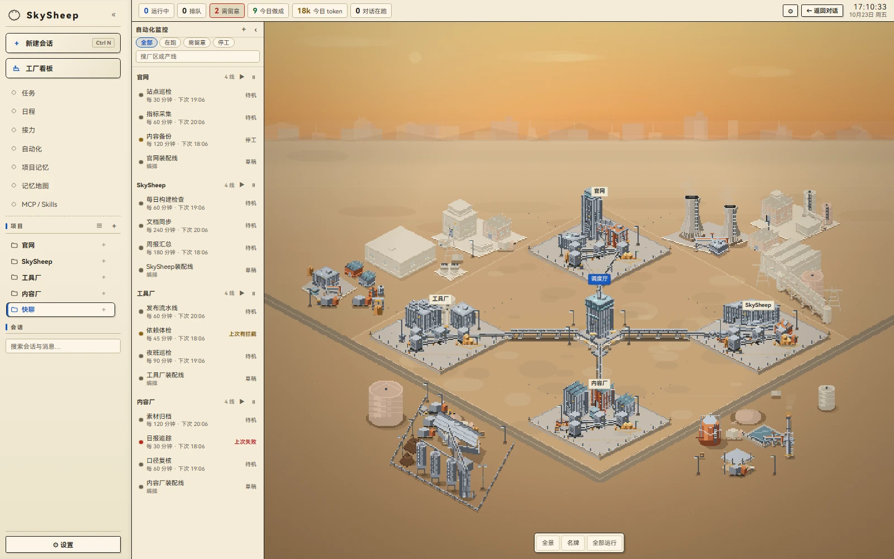

### Memory and archiving

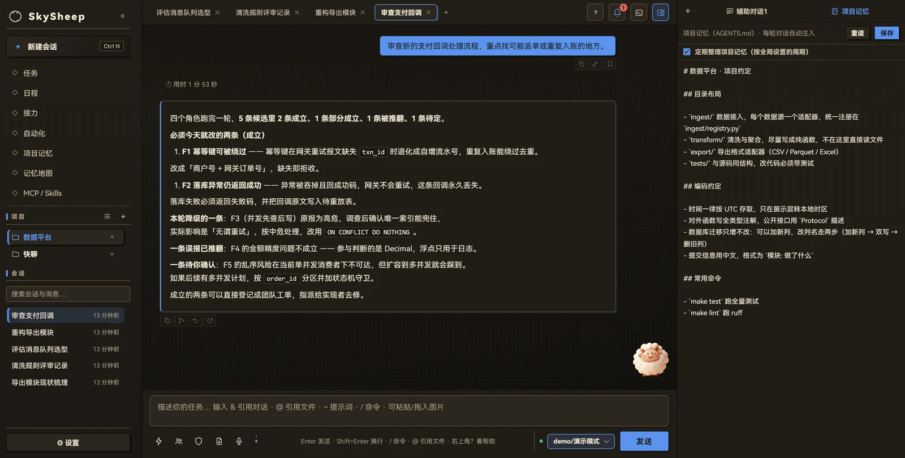

Project memory is edited directly in the UI; global auto memory turns noteworthy facts into pending-review candidates that only reach memory after you adopt them; session archives can be distilled automatically, and the scheduled tidy-up backs up first. The memory map renders a project evolution timeline, a topic association graph, and an LLM-generated evolution summary. When sessions pile up, archive management groups them by project with search and sorting by time or title, and a configurable retention window can sweep stale sessions into the archive automatically — it only flips a flag, deletes nothing, and they can be restored at any time.

### Extending it: MCP / Skills / Mods

Extension points converge on three entry points, and the frontend stays zero-build with no proprietary plugin JS API. **MCP** supports stdio and Streamable HTTP, is Claude Desktop config compatible, ships seven presets, and reconnects automatically after a crash with already-registered tools still working. **Skills** come in global / project scopes, import from a folder, a .zip, or a GitHub/Gitee link, include twenty official scenario templates, and `/save-skill` turns a workflow you just did into a skill draft. **Mods** (experimental) run either in a quickjs sandbox or — switched to the Claude Code plugin format — in a dedicated Node subprocess, so one plugin runs in both. How the whole app reaches the network is decided in one place (Settings → Advanced → Network): proxy, bypass list (curl syntax, including `*.example.com` and CIDR), and a self-signed CA certificate (append semantics; the public chain is not broken) — followed by model calls, web search, web fetch, MCP, command subprocesses, the terminal panel, and the Mods Node runtime.

| MCP servers (one-click presets) | Skills and scenario templates (twenty built in) |
|:---:|:---:|
| 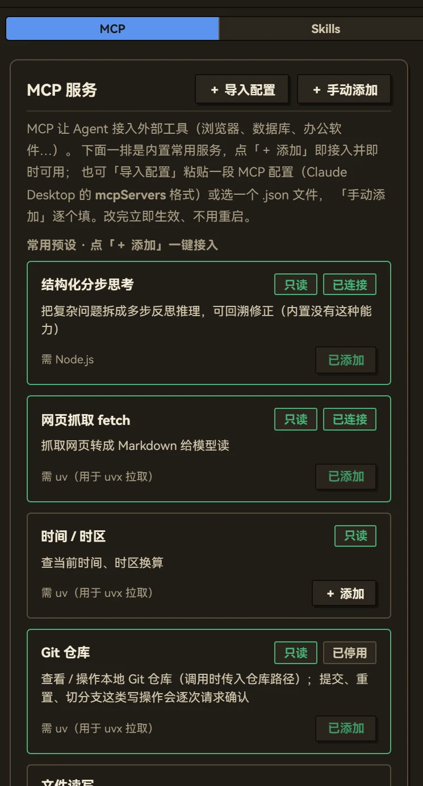 | 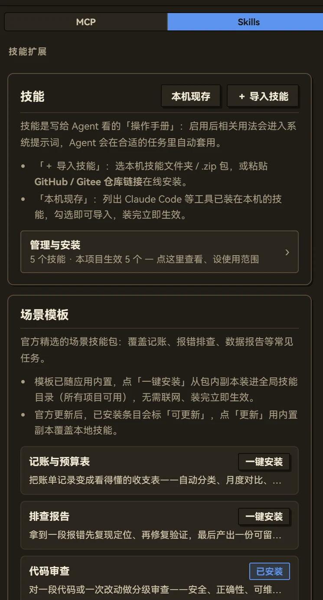 |

## 🔒 Why you can trust it with real work

Safety is the default behavior — no setup required:

- **Confirm every step**: read-only actions run through automatically; file writes (with a diff preview) and command execution prompt for confirmation one by one. Three permission modes — Safe execution / Auto-edit (auto-approves writes inside the working directory only) / Full access; relaxed modes can only be switched from the local UI
- **Command whitelist**: matches by full word prefix; commands carrying shell chaining or interpreter flags never match a rule and always re-confirm; rules persist per project, managed in settings
- **Everything is rollback-able**: file changes are snapshotted per round — undo this round's changes with one click, even after a restart; checkpoints keep 50 rounds per session, 500 per project
- **Local-first**: SkySheep has no cloud service of its own; sessions, config, and keys stay on your machine, with zero telemetry. When you enable a hosted model, conversation content is sent to the provider you selected; web fetch is restricted to public http(s) with SSRF protection; external web / document content is treated as data, never as instructions
- **Recovery is built in**: the session database keeps rolling backups (20 copies) with visual restore; the run center shows the state of every turn and background subagent, and failed or restart-interrupted runs can be re-sent / re-run with one click (only genuinely unfinished runs qualify — completed ones are never replayed, so write tasks can't double-fire); a project's bundled MCP / skill configs require explicit trust first; exported diagnostic bundles redact keys automatically

<details>
<summary><b>Fine-grained mechanisms</b> (expand)</summary>

- Four whitelist rule kinds (whole tool / word prefix / exact arguments / glob); interpreter `-c / -e / --eval` flags are full-text scanned so they can't smuggle a command past a prefix rule; legacy rules that no longer match after the 2.3.0 tightening are badged "stale" in the settings page (hover for the reason) for easy per-rule cleanup
- Shell-chaining detection follows the shell that actually runs the command: on Windows that is `cmd.exe`, where single quotes are not quoting and `%VAR%` expands to a value that may itself contain separators — both count as chaining and fall back to one-by-one confirmation. One POSIX quoting rule is never applied to both platforms
- Computer control converges per action: the action whitelist only remembers the exact confirmed action — closing windows / writing the clipboard is never allowed as a whole tool
- `web_fetch` pins resolved IPs as the connection target (anti-DNS-rebinding) and re-checks redirects hop by hop
- Remote access is scoped per connection: a device holding the token only sees its own current session's runs, tasks, permissions, and status; rotating the token or turning remote access off actively disconnects established remote connections. This is not multi-account isolation — devices sharing one token can switch projects and sessions freely, so hand the token only to devices you trust
- In-app updates require the publisher to ship a `.sha256` checksum; when it is missing the update refuses to auto-install and points you to a manual download. The checksum and the installer come from the same release, so it guards against transfer corruption and one-sided tampering but does **not** prove publisher identity; a failed update is detectable, backed up, and manually recoverable — it does not auto-rollback
- Sub-agents can run in an isolated git worktree (their own branch, auto-committed, merged only when the main session says so), keeping "let it change things" away from your working copy
- MCP tool descriptions are length-capped against context crowding and injected instructions; the system prompt ships with a prompt-injection defense — web / document content is treated as data

</details>

## 🧭 How it differs from terminal agents

Terminal agents like Claude Code or OpenAI Codex CLI excel at scripting and CI integration. SkySheep puts the same class of capability behind a graphical interface and makes multi-model collaboration a native interaction.

| Dimension | Terminal agents | SkySheep |
|---|---|---|
| Interaction | A command-line stream in a terminal, built for scripts and CI | Graphical, Chinese-first: confirmation cards, diffs, and panels live in the UI |
| Multi-model | Usually one model all the way through | Roundtable / team / adversarial, plus the relay workbench |
| Permission confirmation | Command-line flags and rule files | Three graphical tiers + per-action confirmation cards + a per-project command whitelist |
| Rollback | You lean on git yourself | Per-round snapshots, one-click undo, surviving restarts |
| Unattended work | You wire up your own scheduling | Scheduled tasks / dependency pipelines / Task Scheduler export / channel digests |
| Extending | Plugin and script ecosystems | MCP + Skills + Mods, with a zero-build frontend |
| Platforms | Native on macOS / Linux and others | A Windows desktop product |

Conversely, if what you want is scripting inside CI or a pure keyboard-driven workflow, terminal agents remain the better fit; SkySheep ships `skysheep run` headless mode and a terminal REPL as complements.

SkySheep is a **Windows desktop product**: the installer, desktop shell, DPAPI credential encryption, Windows sandbox, window and process management, and `schtasks` export are all built and polished for Windows only. The `--browser` mode can bring up the engine and web UI on macOS / Linux, but that is a developer fallback, not a supported product form (see [Roadmap & Non-goals](#-roadmap--non-goals)).

## 🚀 Installation & Running

**Installer (recommended for everyday users)**

Download `SkySheep-<version>-setup.exe` from [Releases](https://github.com/Sky-scrape/SkySheep/releases/latest) and double-click to install (Windows 10 / 11 x64). If Windows SmartScreen blocks the first launch, click "More info → Run anyway" (standard treatment for unsigned programs; see the [SmartScreen walkthrough](docs/smartscreen-说明.md)).

**Run from source (developers)**

Source runs are supported on Windows; on macOS / Linux the engine and web UI (`--browser`) work, but the desktop shell, credential encryption, and OS-integration features carry no support commitment.

```bash
cd SkySheep/engine
uv sync                          # Install dependencies (Python >= 3.11)
uv run skysheep app              # Desktop app (--browser opens in a browser)
uv run skysheep chat             # Terminal session
uv run skysheep run "task"       # One-shot headless run (JSON output supported)
```

**Initial setup**

A first-launch wizard connects a provider in three steps (pick a service → paste the key → go) and auto-detects local inference services; without an API key you can enter demo mode and watch a full round of real tool calls.

<details>
<summary><b>📦 Double-click launch / packaging</b> (expand)</summary>

```bash
cd engine
.venv\Scripts\python.exe tools\install_shortcut.py        # Start-menu/desktop shortcuts (source build)
.venv\Scripts\python.exe tools\install_shortcut.py --exe  # Point at the packaged SkySheep.exe
.venv\Scripts\pyinstaller.exe --noconfirm --clean SkySheep.spec   # Output: dist/SkySheep/SkySheep.exe (PyInstaller ships with uv sync)
```

Single-file installer: install [Inno Setup 7](https://jrsoftware.org/isdl.php) (6.x does not ship the Simplified Chinese message file with the compiler, which fails the installer build), then run `ISCC.exe tools\installer.iss`; the output lands in `installer/`. Or run `python tools/release.py` for a one-command package → verify → smoke-test → installer chain (build-only by default; `--upload` performs the release upload).

</details>

> **📦 Multiple instances**: source builds run under a `dev` identity by default, with data in `~/.skysheep-dev/` — isolated from the installed app's `~/.skysheep/` and safe to run side by side; the `SKYSHEEP_INSTANCE` environment variable spawns further independent instances.

## 📋 Full capability list

<details>
<summary><b>Expand</b></summary>

**Multi-model collaboration**

- Roundtable: members answer in parallel, the chairman fuses; five member role presets (critic / fact-checker / minimalist / pragmatist and more); debate rounds and A/B mode; drafts persisted with the session for review, citation, and follow-up; seven token-control mechanisms (dedupe, budget clipping, and more)
- Team: task board + role split + team channel; user director or AI director (seven internal tools in a closed loop, all read-only and never passing the permission gate); "small meetings" reuse the roundtable and appear only in the channel; four runaway guards; team templates you can save and reuse; tickets, reports, and channel messages persisted for replay
- Adversarial: discover → investigate → recommend → judge, with asymmetric incentives, isolated stage contexts, and graceful degradation on failure; an upheld finding can be registered as a consulting ticket for a team member (content is read from server-side records — the client cannot forge it)
- Relay: main/peer screens alternating turns; two persisted tables, idempotent requests with version CAS, and an exclusive lock on the data directory; local-only RPC

**Models & conversation**

- Built-in presets for ten cloud services (Anthropic / OpenAI / Gemini / xAI / MiniMax / DeepSeek / Zhipu / Kimi / Qwen / Xiaomi MiMo) plus custom relay endpoints (including local inference services such as LM Studio); one-click model listing and context-window detection, plus a capability probe (streaming / tools / vision / reasoning) and a masked diagnostic report
- Reasoning effort auto-tuned per task; thinking process streamed live and replayable in a collapsible view; a per-session turn-diagnostics panel in the review page breaks down each round's time (tool counts & slowest tool / permission waits / tokens)
- Automatic context compaction (CJK-aware estimation, adjustable trigger ratio; manual `/compact` from the desktop input box — the CLI has no such command)
- Daily token budget guardrails; a channel alert is pushed when usage crosses the 80% / 100% tiers (at most one per tier per day; alerts follow the channels — with no chat / Webhook channel enabled there is no alert, and the in-app guardrail still applies); usage dashboard by session / provider / model with cost estimation
- Auxiliary chat runs as multiple independent instances, each with its own model and history and none of them touching the main conversation; tabs can be dragged to reorder, renamed inline, and managed from a right-click menu
- Prompt library (pinyin-initial filtering, AI polish, import/export); `~` prompts, `/` commands, `@` file references, `&` conversation references; voice input

**Task execution**

- 30 built-in tools: file read/write, precise editing, directory operations and glob search, command execution (with background process management), regex search, web fetch and search (multiple providers), PDF / Word / Excel / PPT / CSV I/O, image understanding, AI image generation, task lists, memory writes, scheduling, skill loading, and pipeline authoring. Web fetch ships injection defense — external content is wrapped in an explicit boundary frame declaring that instructions inside it are not yours, and a suspected-injection hint is appended when known injection patterns are detected
- Three more tools for sub-agents (`spawn_agent` / `check_task` / `wait_task`): six built-in roles + custom roles (tool scope / model / reasoning effort configurable); parallel background execution with queuing; isolated spawns on a dedicated git worktree that auto-commits to its own branch
- Computer and browser control: screenshot, mouse, keyboard, window, clipboard, browser opening / in-page automation (off by default; enable in settings — certificate verification and browser-data clearing live on the same "Browser control" page)
- Execute / plan dual mode with a live-synced task list; task duration estimates and actual-time logging
- Per-round checkpoints — undo this round's file changes with one click; rollbacks survive restarts

**Automation & memory**

- Scheduled tasks and agenda reminders; task pipelines (declare `all` / `any` dependencies and conditional branches, concurrency limits and per-node timeouts, retry with the failure reason attached, node output summarized into downstream nodes); exportable as Windows scheduled tasks; the automation panel's "Today" card summarizes the day's runs
- Channel pushes: Feishu / WeChat / generic Webhook; channels are read-only by default, with optional approval cards and timeout auto-deny
- Project memory edited in-app; global auto memory; archive-time memory distillation; scheduled memory tidy-up (originals backed up first); oversized global memory is injected by per-turn relevance (embedding-similarity ranking via a local Ollama when installed, rule scoring otherwise)
- Memory map: project evolution timeline, topic association graph, LLM-generated evolution summary
- Hooks: pre tool-call (can block) / post / task-finished, with a tester and a recent-runs panel
- `skysheep run` headless one-shot execution: pre-authorized tool list, JSON output, script-friendly

**Extensions & connectivity**

- MCP client: stdio / Streamable HTTP, Claude Desktop config compatible, seven built-in presets, bounded auto-reconnect
- Skills: global / project scopes; import from a folder, a .zip, or a link, plus scan-and-import; twenty official scenario templates; `/save-skill`
- Mods: quickjs sandbox or the Claude Code plugin format (experimental, one at a time); UI extension points and tool registration go through fixed renderers, and permission decisions can only tighten
- Network: global proxy / bypass list / self-signed CA; a per-provider proxy can override the global one (three states: follow global / explicit direct / use this proxy), and local services always connect directly
- Remote access: LAN token + QR code; Tailscale supported for cross-network access (security boundaries and advice in [docs/远程访问安全.md](docs/远程访问安全.md))
- Desktop form factor: six themes + follow-system, system tray, launch at startup, window geometry memory, global hotkey, desktop pet; multiple session tabs, an eleven-tab right panel (auxiliary chat / browser / review / files / tasks / agenda / automation / project memory / memory map / relay / MCP·Skills), and a multi-tab terminal docked at the bottom (Ctrl+\` toggle)
- Session management: full-text search (Chinese-aware), session branching, pin / archive / tags, Markdown / HTML export, rolling backups with visual restore

</details>

## 🏗 Architecture

```
┌──────────────────────────────────────────────────────────────────┐
│ Desktop shell: pywebview native window (WebView2)                │
│  └─ Browser fallback (--browser)                                 │
├──────────────────────────────────────────────────────────────────┤
│ Local server layer: FastAPI + WebSocket                          │
│  └─ JSON-RPC requests + AgentEvent event stream                  │
│  └─ Zero-build frontend (vanilla HTML/CSS/JS, served statically) │
├──────────────────────────────────────────────────────────────────┤
│ SkySheep Engine (Python 3.11+, asyncio)                          │
│  ├─ core/      Agent loop, event stream, sub-agents,             │
│  │             compaction, checkpoints, roundtable/team/adv.     │
│  ├─ models/    Provider layer (openai/anthropic/fake)            │
│  ├─ tools/     Built-in tools (incl. web_fetch) + schema export  │
│  ├─ security/  Permission Gate + whitelist + write leases        │
│  ├─ skills/    Skill discovery / toggle / injection / install    │
│  ├─ mcp/       MCP client (stdio/HTTP)                           │
│  ├─ session/   SQLite persistence + full-text search             │
│  ├─ config.py  ~/.skysheep/config.toml                           │
│  └─ cli/       Terminal REPL / desktop launcher                  │
└──────────────────────────────────────────────────────────────────┘
```

Design keynote: **event-stream driven** — the entire agent run is modeled as `AgentEvent`s, and the CLI, GUI, and WebSocket server all consume the same engine API; sensitive operations go through the `PermissionGate`, which emits a confirmation event and suspends until the frontend decides.

Auditability: all project source (the Python engine and the frontend HTML/CSS/JS) ships as readable, unobfuscated code; the mermaid/xterm bundles under `static/vendor/` are upstream build artifacts of third-party libraries (versions pinned, never modified).

## 🤝 Development & Contributing

Bug fixes, docs, tests, and experience polish are all welcome — as are new skill packages and MCP configs drawn from real workflows. Before opening a PR, please check:

- Use `uv` (Python >= 3.11); the frontend stays zero-build — edit `engine/src/skysheep/server/static/` directly, no Node / npm toolchain
- Run `uv run pytest` (`-m "not e2e"` skips the real-socket tests, `-m eval` runs the behavioral eval baseline) and `uv run ruff check .`
- A new feature usually touches four places: `server/backend.py` plus a `dispatch()` branch in `server/app.py`, then `static/index.html` and `static/app.js` (settings pages have their own convention; config reads/writes go through `config.py`'s `_read_raw_config` / `_write_raw_config`)
- A new tool must declare `safety` on `Tool` and spell out the four MCP annotations; anything that writes files or runs commands must go through the `PermissionGate` — this is not negotiable
- Text reads and writes always go through `textio.py` (encoding and line-ending safety); move / delete / make-directory use the dedicated reversible tools rather than teaching the agent `mv` / `rm` / `mkdir` inside `run_command`
- A new mergeable streaming event kind must be added to `_MERGEABLE_DELTA_KINDS`, and all three paths — turn end, exception, cancellation — must flush
- Version consistency across six places is machine-checked by `engine/tools/check_versions.py`; the `uv.lock` copy is held by `uv sync --locked`
- Packaging and packaging smoke tests use the executables in `.venv` directly, never via `uv run`

Security vulnerabilities go through the private channel in [SECURITY.md](SECURITY.md) — please don't open a public issue. Everything else is in [CONTRIBUTING.md](CONTRIBUTING.md), with the code of conduct in [CODE_OF_CONDUCT.md](CODE_OF_CONDUCT.md). Running into a problem? In the app, go to Settings → About → "💬 Report an issue" to auto-package a redacted diagnostic bundle and open the feedback page.

## 🗺 Roadmap & Non-goals

- ✅ current release **v2.6.2**: the multi-model collaboration workbench now covers roundtable / team / adversarial / relay, task pipelines, the visual factory board, global egress settings, and the MCP / Skills / Mods extension ecosystem (full history in [CHANGELOG.md](CHANGELOG.md))
- 🚧 **Next up**: code-signed distribution · Windows desktop polish and stability (until then, see [docs/smartscreen-说明.md](docs/smartscreen-说明.md) for the SmartScreen workaround for unsigned installers)

**Non-goals**:

- **Native mobile apps** — the desktop shell is the carrier for permission confirmation, checkpoints, and other safety interactions; there is no mobile-grade security model at this stage. The web PWA is already supported (add to home screen).
- **macOS / Linux desktop support (for now)** — SkySheep is a Windows desktop product: its security model (DPAPI credential encryption, the Windows sandbox, window and process management, `schtasks` scheduling) rests on Windows. The `--browser` mode can run the engine and web UI on macOS / Linux as a developer fallback, not as a supported product form. Other platforms get reconsidered only once the Windows desktop reaches a stable bar.
- **Vector memory / multi-tier context compaction** — the built-in compaction and archive-time memory digests already cover current usage; not worth growing the install size.
- **Replacing the built-in search with ripgrep** — pure-Python, zero-dependency "install and it works" distribution stays; no bundled binary, but an installed rg may optionally accelerate search.
- **A proprietary plugin JS API** — extension points stay on the three entry points, MCP, Skills, and Mods; the frontend remains zero-build.
- **An operated skill marketplace** — skills ship via the in-app import flow (folder / .zip / links); no curated store to moderate.

## 📄 License & Sponsorship

Released under the [MIT](LICENSE) license: use it, modify it, and distribute it freely, including commercially — just keep the copyright and license notice.

Donations are accepted via the channel listed in [.github/FUNDING.yml](.github/FUNDING.yml) — GitHub Sponsors: [Sky-scrape](https://github.com/sponsors/Sky-scrape). The first spending priority is **code-signed distribution**: signed installers remove the Windows SmartScreen warning (see [docs/smartscreen-说明.md](docs/smartscreen-说明.md)) so everyday users can install with a double-click.

---

<div align="center">

☁️ **The cloud sheep is with you** ☁️

</div>
