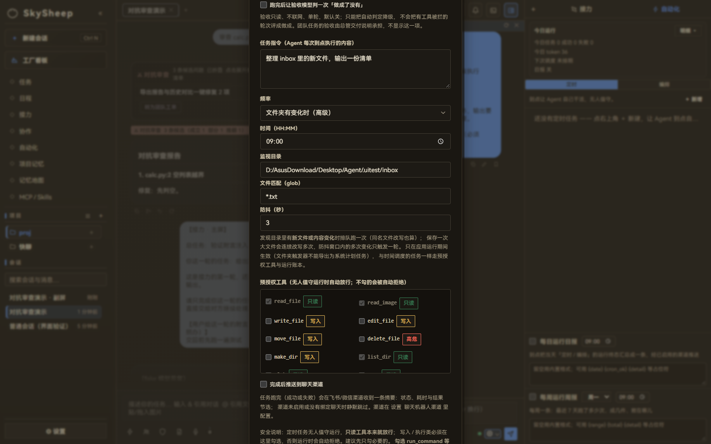
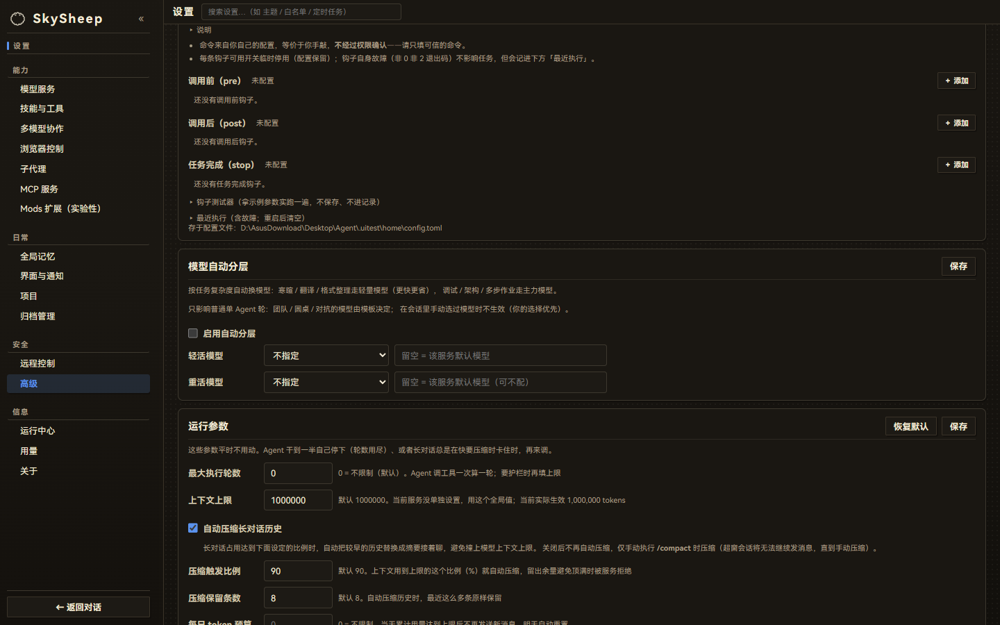

# SkySheep v2.7.1 · 盯着文件夹，按复杂度挑模型，让团队分头改

这版把「自动化」往实处推了一步：定时任务可以盯一个文件夹、有变化才干活；团队可以每个队员在各自的分支上动手；日常对话能按任务轻重自动换模型。顺手把对抗审查和接力补成了闭环。

## 这版你能感觉到什么

- **文件夹有变化，任务自己开工**：定时任务新增一档「文件夹有变化时（高级）」——指定一个目录和匹配规则（例如 `*.pdf`），发现新文件或同名文件内容变化就排队跑一次，不必再按固定时间空转。保存一次大文件会连续改写多次，防抖窗口内只触发一轮；触发走的是定时任务原有那套（预授权工具、无人值守门控、运行账本、渠道推送）。只在应用运行期间生效，也不能导出成系统计划任务（系统计划任务只有时间维度）。
- **对抗审查查出问题，一键变成修复任务**：审查卡上新增「一键修复 N 项」，把裁判认定成立、部分成立的问题（位置、问题描述、修复建议、验收口径）拼成一段修复指令放进输入框；已推翻的不会混进来。只回填不发送——修不修、在本会话修还是转给团队，仍由你决定。
- **模型按任务轻重自动换**：设置 · 高级新增「模型自动分层」（默认关）。开启后，寒暄、翻译、格式整理这类轻活走你指定的轻量模型（更快更省），调试、架构、多步作业走主力模型。只在普通单 Agent 轮生效：团队 / 圆桌 / 对抗的模型由模板决定；你在会话里手动选过模型时不替你改；配的服务不可用就静默留在原模型，不耽误这一轮。
- **团队可以分头改，再逐个合并**：设置 · 多模型协作 · 团队新增「隔离执行」（默认关）。开启后执行型队员每轮跑在自己的 git worktree 分支上（`skysheep/team-*`），主工作区完全不受影响；每轮完成自动提交到该分支，并在团队频道提示「复核并合并」——合并仍由你在会话里执行，引擎不会自动 merge。命令与工作区外的写入照常走权限门；不是 git 仓库的项目自动退回共享工作区。
- **接力可以叮嘱下一轮一句话**：看板的「下一轮附言（只生效一次）」随下一次换手写进交接简报（因此也进复述核验），开轮成功后自动清空。刻意不落库：这是短时间的运行意图，重启后不保留，面板上已写明。
- **团队总管也能看到你点名的文件**：团队 AI 总管没有文件工具，以前说「按 calc.py 拆活」它只能盲拆；现在会把你点名、上下文还没读过的项目文件只读带进下一轮总管唤醒。只给总管看，团队频道里仍是你的原文。
- **右栏一键互切，设置说清谁生效**：预览分栏和会话分屏共用右侧空间，现在顶栏一个 ⇄ 按钮来回切，并记住上次的分屏会话与预览页。设置 · 多模型协作的高级折叠区在折叠状态下就写明「模板限额填了非 0 就以模板为准」，不必两处对照猜。

## 怎么装

Windows 10 / 11 x64。安装包 `SkySheep-2.7.1-setup.exe`，未签名。
首次运行如遇 SmartScreen：点「更多信息 → 仍要运行」，详见 [SmartScreen 说明](https://github.com/sky-scrape/SkySheep/blob/main/docs/smartscreen-%E8%AF%B4%E6%98%8E.md)。
sha256：`0000000000000000000000000000000000000000000000000000000000000000`

## 升级说明

覆盖安装即可；会话、配置与密钥在 `~/.skysheep/` 不动，检查点与历史照常保留。新设置项（模型自动分层、团队隔离执行）默认都关，升级后行为与 2.7.0 一致，需要时再打开。

工程细节与边界（10 条）

- **文件夹触发**：规格（目录 / glob / 防抖秒数）以 JSON 存在定时任务原有的 `time_of_day` 文本列里，不加列、不升库版本；5 秒轮询只做 stat，发现变化把 `next_run_at` 顶到当前时刻，执行、门控、通知、运行账本、工厂观战全部复用既有链路。防抖窗口内多次改写只触发一轮，窗口最后一次变化记 pending 到期补触发；目录不存在或 glob 带路径分隔符在入口拒绝（不静默建空目录）；非 git 无关。
- **一键修复**：新增只读方法 `adversarial.fix_prompt`，正文只从库内 meta 组装（与导出同一事实源），归属校验同 `messages.earlier` 口径；已推翻的发现不进指令，前端只回填不发送。
- **模型分层**：新 `[routing]` 段（enabled / light_provider / light_model / heavy_provider / heavy_model，默认关）。复杂度信号复用思考强度的启发式 `estimate_effort`，零额外请求；只在普通单 Agent 轮临时替换 provider，轮末按对象身份还原并释放；会话级模型覆盖（`_session_models`）优先，不路由。
- **团队隔离执行**：新 `[team] isolated_tasks`（默认关）。每位执行型队员懒建 `<项目>/.skysheep/worktrees/team-<团队id>-<队员>` 与 `skysheep/team-*` 分支；`TeamIsolatedGate` 对 worktree 内写入直接放行（隔离即确认），命令与外部写入交还会话门（取严），出站密钥与引擎主目录守卫仍先于放行判定。每轮完成 `commit_all` 提交并在频道给合并提示；提交失败只记注记，不把完成轮判失败；非 git 自动退化。
- **接力附言**：存在 runner 内存（`next_notes`），写进交接 brief 后才算消费，交接门暂停/报错时保留可重试；开轮成功即清空并随 `relay_pair_state` 广播回前端。不落库是为了不为一句运行期意图升库版本，面板文案已说明重启不保留。
- **团队预读**：`run_auto_turn` / `inject_user_message` 新增 `director_context`，一次性注入下一总管轮唤醒后清空；不进频道、不落库；接管（takeover）时未消费的清掉。
- **拆块**：前端消息导航条（`miniMsgsFor` / `createChatMinimap` / `MINI_*`）整体搬到 `static/app-minimap.js`（排在 app.js 前，主栏实例仍由 app.js 建）；后端圆桌轮主体与「提到就带上」预取搬到 `backend_parts/roundtable_body.py`（`RoundtableBodyMixin`），`_dump_emit` / `_strip_image_blocks` 下沉 `backend_parts/_shared.py`；`SW_VERSION` 升到 v135，`SHELL_URLS` 与 no-store 清单同步。
- **右栏互切**：顶栏 ⇄ 按 `previewSplitOpen` / 分屏列数显隐，切走时记住上次分屏会话与预览地址；接力顺带打开副屏列时也会刷新按钮状态。
- **可观测性与容错**：会话库连接时读回 `journal_mode`，不是 WAL 就留一条带路径的警告（此前只发 PRAGMA 不看返回值，网络盘上静默退化查不出）；Node 探测与测试里剩余 `text=True` 的 subprocess 全部补 `encoding="utf-8", errors="replace"`，消掉本地化系统上的 reader 线程解码告警。
- **验证**：全量 4143 passed / 14 skipped；acceptance 42 passed / 3 skipped；e2e 36 passed / 3 skipped；browser UI（Playwright）10 passed；ruff 全绿；CI 五项全绿（lint & test / e2e / browser UI / pip-audit）。

完整变更见 [CHANGELOG.md](https://github.com/sky-scrape/SkySheep/blob/main/CHANGELOG.md) 的 2.7.1 条目。
