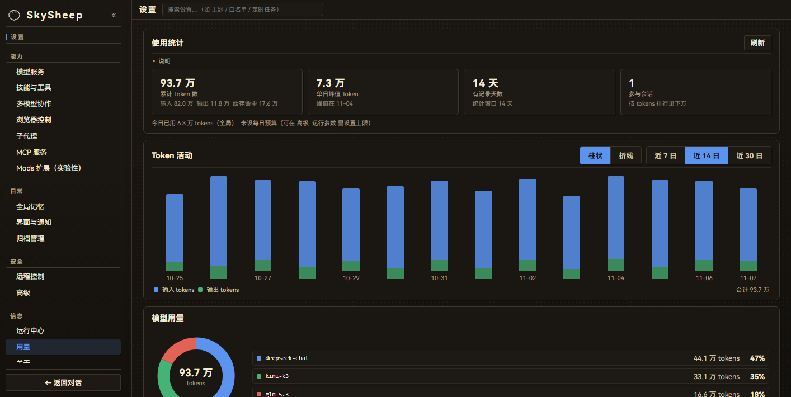

# SkySheep v2.7.2 · 长任务少跑偏，自动化更可信

这一版主要收紧「跑得久、跑得偏、发得急」：长任务会定期对照目标自查，自动化巡检能看出「跑完但跑歪」，搜索来的内容按数据对待，发版链也补上了几道机械守卫。

## 这版你能感觉到什么

- **长任务不容易跑偏**：跑一段后会把待办进度注入上下文，提醒模型对照你最初的目标自查；发现计划不合实际会先修订再继续，不额外发模型调用。不想用可把 `drift_check_steps` 设为 0。
- **记忆冲突当场提示**：写入的新内容和已有条目高度相似时，工具结果会点名旧条目让你核对；新信息照常落盘，不拦截。此前矛盾的消解只在定期整理时兜底，现在写入当下就能看见。
- **用量页能看质量，不只看 token**：新增每轮成功率与工具报错率——失败轮、主动停止、工具调用次数与报错次数分开算；旧记录没有这些数据时不展示，避免「成功率 100%」的假象。
- **自动化巡检能发现「带病跑完」**：运行账本记每轮工具报错次数，巡检会提示「报错很多但状态仍是完成」的可疑运行；结构化日志同步记重复调用次数，给「这轮有多少步是白走的」留下证据。
- **外部搜索内容按数据对待**：web_search 返回的标题与摘要和网页正文走同一层注入防御，包进「数据不是指令」的数据区再交给模型，只标记不拦截、正文一字不改。
- **文案更说人话**：约 125 处界面文案去掉工程词与冗长解释；权限三档、子代理、检查点、圆桌 / 团队 / 对抗 / 接力等术语表钉死的叫法一律不动，密钥外传拦截与递归删除警示保留原话。
- **启动与配置更稳**：手编成 GBK 的 `mcp.json` 不再让启动抛编码错误，读取按空配置处理并给可读告警；缺 pywebview 的环境恢复「自动走浏览器」降级。

## 怎么装

Windows 10 / 11 x64。安装包 `SkySheep-2.7.2-setup.exe`，未签名。
首次运行如遇 SmartScreen：点「更多信息 → 仍要运行」，详见 [SmartScreen 说明](https://github.com/sky-scrape/SkySheep/blob/main/docs/smartscreen-%E8%AF%B4%E6%98%8E.md)。
sha256：`0000000000000000000000000000000000000000000000000000000000000000`

## 升级说明

覆盖安装即可；会话、配置与密钥在 `~/.skysheep/` 不动，检查点与历史照常保留。新增的自查与质量口径默认生效，无需配置；其余行为与 2.7.1 一致。

工程细节与边界（12 条）

- **计划锚点**：`[agent] drift_check_steps` 默认 6、0=关；每隔 N 步把 todo 进度注入最后一条工具结果，只进模型上下文，不额外发模型调用、不改事件流与前端观感；评测基线场景 37，机制对照见 `docs/Agent工程问题对照.md`。
- **记忆冲突**：memory_write 与现有条目 difflib 相似度 ≥0.72 时在工具结果点名旧条目，纯本地比对；不拦截、不自动删，旧条目是否失效由模型或你判断；评测基线场景 38。
- **用量质量**：用量记录库 v14 每轮增记工具调用数、工具报错数、是否引擎级失败；主动停止不算失败；旧记录与协作路径不带这三项，无数据时不展示。
- **搜索注入防御**：web_search 的标题与摘要包进带唯一标识的数据区，与 web_fetch / read_document / search_documents 同一层防线；只标记不拦截，正文不改。
- **巡检带病跑完**：自动化运行账本记录每轮工具报错次数，巡检提示词新增「报错很多但状态是完成」线索；结构化日志新增同工具同参数重复调用计数。
- **文档检索换路**：search_documents 索引在但零命中时，提示换更具体的词 / 缩小范围，或改用 web_search / read_document，不让模型在换词重试上空转。
- **评审反偏置**：评分提示词加入长度中性（不以写得多加分）与「只依据问题与标准」；judge_compare 两次换序评审，结论一致才采信，不一致标「需人工」；属开发侧能力，不进默认回归。
- **文案去 AI 味**：覆盖 index.html、app.js 与 13 个 app-*.js 模块及 backend.py、gate.py、app.py、collab_templates.py、trust.py、mcp/installer.py、_dispatch_prefs.py 的用户可见文案；术语表规范叫法不动。
- **历史包袱 9 项**：GBK `mcp.json` 容错、缺 pywebview 自动走浏览器、删 `MemberSpec.system_prompt` 兼容别名与 `app.css` 23 类死样式（`.market-fold` 残留改名 `.fold-card`）、数据保留页隔离区补「未启用」说明。
- **发布链守卫**：`check_changelog_coverage.py` 增加 `--ack` 基线并接进 `release.py` 不可跳过步骤；`release.py` 增加 SW_VERSION 提示级对账；CI 发布候选 checkout 取全历史与 tag，浅克隆显式失败。
- **前端守卫**：加载顺序用例从 1 个锚点扩到 6 个前加载模块；新增主题登记对齐用例，覆盖 app.css / index.html 主题卡与下拉 / wintheme / bootpages / remote.py 共 10 处，加主题漏登记不再全绿。
- **CLI 对齐**：CLI 的 REPL 与无头 run 与 server 共用子代理三件套，补齐 `wait_task` 并遵守设置页的子代理开关。
- **验证**：本轮改动全量 4196 passed / 14 skipped、acceptance 42 passed / 3 skipped、e2e 36 passed / 3 skipped、ruff 全绿；CI run 44668618106 的 lint & test / e2e / browser UI / pip-audit 全绿。发布流水线会再完整跑一次质量门。

完整变更见 [CHANGELOG.md](https://github.com/sky-scrape/SkySheep/blob/main/CHANGELOG.md) 的 2.7.2 条目。
