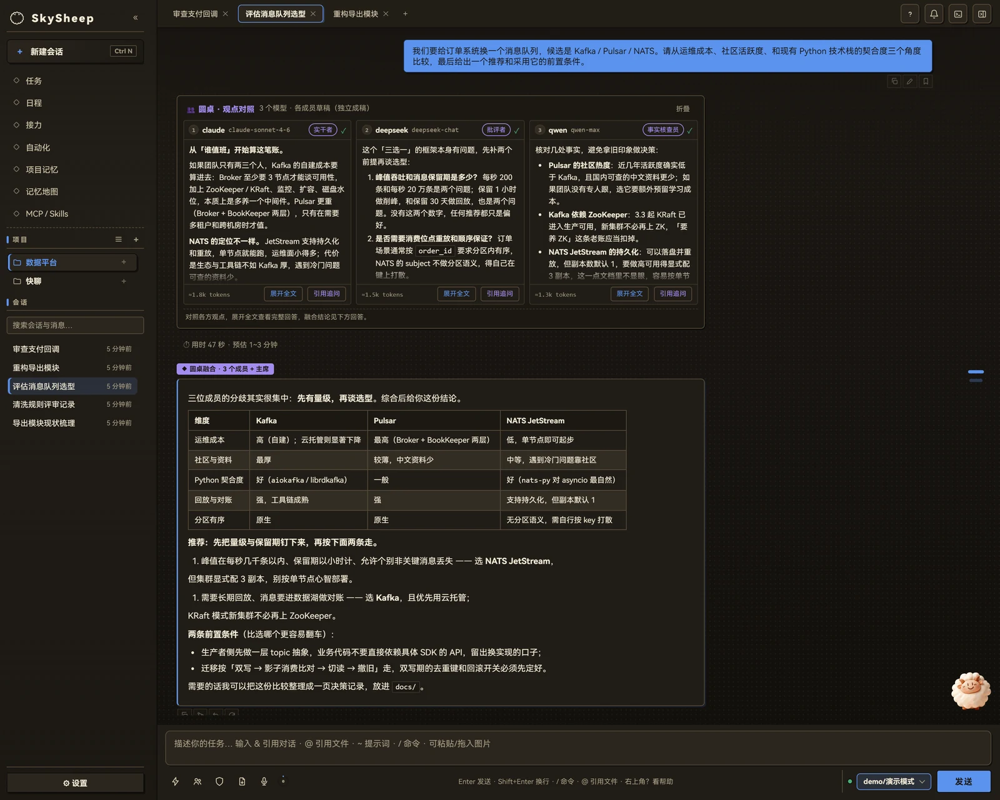

# SkySheep v2.7.3 · 地基加固：出站防线可查、凭据降级会提醒、检索提速

这一版没有新玩法，主要把地基做结实：权限门的静默降级从此有迹可查，凭据加密失败会明确提醒你，文档检索重复提问明显提速；同时把圆桌/对抗的成员调用、权限门的判定逻辑、前端的巨型文件做了大瘦身。全部行为除一处提示外与 2.7.2 完全一致。

## 这版你能感觉到什么

- **凭据加密失败会明确提醒**：Windows 上凭据加密（DPAPI）不可用或失败时，凭据此前会按明文落盘且只在日志里提一句；现在设置 · 高级会亮「凭据未能加密」提示（本次页面会话内可关闭），「已加密」不再被静默降级。非 Windows 的明文本就是平台基线，不提醒。
- **出站防线为什么静默，可查了**：权限门的出站密钥扫描、mcp.json / config.toml 读障此前静默降级，现在记 `egress_scan_failed` 等结构化日志——「防线为何整轮没拦」「凭据面为何从已知密钥表消失」不再靠猜。防线行为一字未改。
- **排障不再靠猜**：写租约领取失败、联网搜索 / 画图配置解析失败、运行账本、巡检循环、渠道停止、CLI 记账、运行快照等 26 处静默吞错补上结构化日志；全局热键保存失败从「谎报成功」改为给前端可读错误。全部行为语义不变，只把「发生过什么」留下来。
- **文档检索重复提问更快**：`search_documents` 按「库文件大小 + 修改时间」缓存分块与打分统计，同一文档库连续追问不再重复读库与分词；任何写库都会让缓存自然换代，检索结果与之前逐字段一致。
- **协作与权限门更稳**：圆桌 / 对抗的成员调用收敛为共享运行时（超时、取消、重试语义逐点不变），权限门的确认判定收敛为单一决策源——审计发现的 5 处确认面分歧按更严一侧统一（含渠道门），权限面无一放宽。
- **前端大瘦身（观感零变化）**：app.js 从 20,039 行拆到 16,928 行——事件常量、协作卡片、聊天 / 流式渲染分三个独立模块，每一步都有「符号集合零丢失零重复」的机械证明与常驻红灯护栏。

## 怎么装

Windows 10 / 11 x64。安装包 `SkySheep-2.7.3-setup.exe`，未签名。
首次运行如遇 SmartScreen：点「更多信息 → 仍要运行」，详见 [SmartScreen 说明](https://github.com/sky-scrape/SkySheep/blob/main/docs/smartscreen-%E8%AF%B4%E6%98%8E.md)。
sha256：`7c73fd03d3abbeff5c434268477194566972b57f54c672446e448d21e49443ef`

## 升级说明

覆盖安装即可；会话、配置与密钥在 `~/.skysheep/` 不动，检查点与历史照常保留。凭据降级提示默认生效，无需配置；其余行为与 2.7.2 一致。

工程细节与边界（9 条）

- **出站防线留痕**：`egress_scan_failed` / `egress_mcp_json_failed` / `egress_config_failed` 三处由静默降级改为 obs 告警；mcp.json 不存在是「从未配置过 MCP」的常态，不算降级、不告警；放行判定与空表降级逻辑逐分支不变。
- **吞错收窄 26 处**：写租约（`lease_claim_failed`）、能力装配（`capability_resolve_failed`，配错不再「工具静默消失」）、RunLedger 收敛单一契约（warning 留痕后吞错，取消照常穿透）、自动归档 / 保留策略巡检循环、渠道停止（单个渠道停不掉不再无声，飞书残留长连接可查）、CLI 无人值守用量记账（debug 留痕）、运行快照写失败（debug）；全局热键保存失败改为回错误帧——29 处里唯一从吞错改报错的，降级事实不变，只是不再谎报成功。
- **凭据降级标记**：`secure_store` 进程内 `_mark_degraded`，DPAPI 不可用 / CryptProtectData 失败两条路径点亮；非 Windows 明文是平台基线不点亮；前端提示锚稳定 id（adv-credential-crypto-warn）。
- **文档检索缓存**：按「库文件 stamp（大小 + 修改时间）」缓存分块行与 BM25 语料统计，LRU 上限（4 库 / 32 条语料）；契约测试钉住与通用打分逐 float 相等，写库后显式失效一次兜底粗粒度文件系统。
- **成员文本轮收敛**：新建 `core/member_runtime.py`，圆桌成员轮与融合轮、对抗文本轮三处近重复骨架（流式收集 / 用量 / 超时 / 重试 / 取消）收敛为 `run_member_text` 单一实现，差异策略化（取消双协议、用量双口径、预算双策略）；团队消费 `agent.run_turn` 事件流、接力的部分文本不落库是 CAS 原子性的一部分，均按设计裁决暂不迁移。
- **权限门单一决策源**：新建 `security/decision.py`（Tier 枚举 + 纯同步 `decide`），`needs_confirm` 与 `authorize` 的「同序同条件手工同步」从注释承诺变成结构保证；审计发现的 5 处确认面分歧统一取严（含渠道门覆写），此前注释列过的 memory_write / egress 两起漂移事故有回归用例。
- **工具注册收敛**：`tools/__init__.py` 的 import / default_tools / `__all__` / `COMPUTER_TOOL_NAMES` 四处手工清单收敛为 `_TOOL_SPECS` 单一清单派生；新增完备性契约（`Tool.__subclasses__()` 全量收集 45 类两头比对，14 个装配注入例外逐条留痕），新工具漏登记即红灯。
- **前端拆分三批**：`app-events.js`（34 个事件 kind 由 `tools/gen_frontend_events.py` 生成，`--check` 防过期，app.js 48 处比较切常量）、`app-cards.js`（协作卡片 92 符号整簇搬移）、`app-chat.js`（聊天 / 流式渲染 42 符号，加载顺序反转为 before_app 化解加载期 TDZ）；每批都有顶层符号集合零丢失零重复的机械证明与常驻红灯护栏；SW_VERSION v138→v140。
- **验证**：各批均跑五道门（ruff / acceptance 42 passed 3 skipped / 全量单元 / e2e 36 passed / eval 行为评测）全绿；最新全量 4238 passed / 14 skipped；CI 每批独立全绿（lint & test / e2e / browser UI / pip-audit）。发布流水线会再完整跑一次质量门。

完整变更见 [CHANGELOG.md](https://github.com/sky-scrape/SkySheep/blob/main/CHANGELOG.md) 的 2.7.3 条目。
